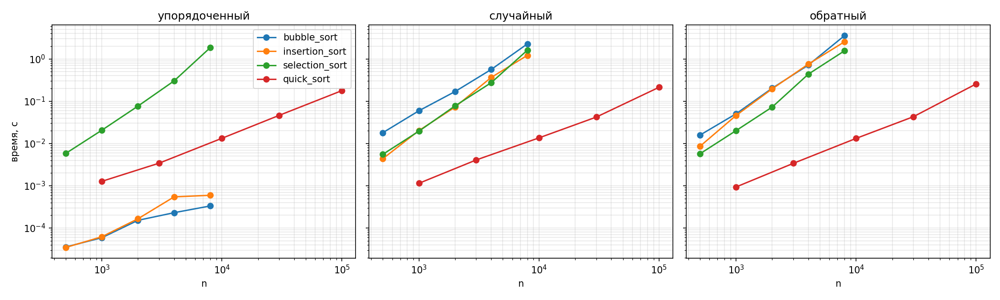

# Лабораторная работа 3. Простые сортировки и QuickSort

Вариант 14 (seed = 30 + 14 = 44). Код: `lab03-simple-sorts-quicksort.py`, график: `lab03_loglog_seed44.png`.

## Что сделано

Написал три простые сортировки (пузырёк, вставки, выбор) со счётчиками сравнений и обменов и QuickSort со случайным опорным элементом. Потом измерил время на трёх видах входа (упорядоченный, случайный, обратный), сравнил с теорией и проверил, какие сортировки стабильны.

Все функции работают с копией входа. Простые сортировки возвращают список, число сравнений и число обменов (у вставок это сдвиги). QuickSort возвращает новый список, а генератор `random.Random` передаётся в него снаружи, чтобы запуск повторялся по seed.

Про пузырёк: добавил флаг «за проход не было обменов», тогда на упорядоченном массиве он делает один проход. Без этого флага у него не было бы лучшего случая.

В QuickSort опорный берётся как `a[rng.randrange(lo, hi)]`, потом ставится в конец, и один проход переносит все меньшие элементы налево. Базой рекурсии служит подмассив из 0 или 1 элемента. Отдельной обработки малых подмассивов (вставками, например) я не делал, мне хватило базы.

## Проверка

Сначала запускается `self_check()`. Он проверяет пустой массив, один элемент, все элементы равны, упорядоченный и обратный массивы. Для каждого результата проверяется, что он упорядочен и что это перестановка входа. Потом все четыре сортировки сверяются с `sorted()` на 300 случайных массивах длиной до 80. Ещё проверяется, что у сортировки выбора на 5 элементах ровно 10 сравнений. Всё прошло, на выходе `self_check: OK`.

Использование ИИ: помощь с реализацией и пояснениями (заменить на то, что было на самом деле). Результат проверен описанным выше `self_check`, сам код я разобрал и могу объяснить.

## Стабильность

Взял пары (ключ, метка) `[(2,"a"), (1,"b"), (2,"c"), (1,"d")]` и сортировал только по ключу. Результат:

| сортировка | порядок меток при равных ключах | вывод |
| --- | --- | --- |
| bubble_sort | (1,b) (1,d) (2,a) (2,c) | стабильна |
| insertion_sort | (1,b) (1,d) (2,a) (2,c) | стабильна |
| selection_sort | (1,b) (1,d) (2,c) (2,a) | нестабильна |
| quick_sort | (1,b) (1,d) (2,a) (2,c) | нестабильна |

У QuickSort на этом маленьком примере порядок случайно сохранился, поэтому вывод о нестабильности я делаю по второму тесту: 40 пар с четырьмя разными ключами, результат сравнивается с `sorted()` (он стабильный). Там QuickSort порядок меток нарушил.

У выбора причина видна на примере: минимум `(1,b)` меняется местами с `(2,a)`, и `a` оказывается после `c`. Обмен перепрыгивает через равный элемент.

## Замеры

Для каждого размера делался один прогрев и 5 запусков на свежих копиях, в таблицах медиана, секунды. Для простых сортировок размеры 500, 1000, 2000, 4000, 8000, для QuickSort 1000, 3000, 10000, 30000, 100000.

Простые сортировки:

| алгоритм | вход | 500 | 1000 | 2000 | 4000 | 8000 |
| --- | --- | --- | --- | --- | --- | --- |
| bubble | упорядоченный | 0.000036 | 0.000059 | 0.000152 | 0.000231 | 0.000333 |
| bubble | случайный | 0.017958 | 0.059385 | 0.168970 | 0.562502 | 2.261787 |
| bubble | обратный | 0.015730 | 0.050294 | 0.202976 | 0.715282 | 3.550448 |
| insertion | упорядоченный | 0.000035 | 0.000062 | 0.000165 | 0.000545 | 0.000594 |
| insertion | случайный | 0.004353 | 0.020179 | 0.072760 | 0.364635 | 1.212451 |
| insertion | обратный | 0.008543 | 0.045941 | 0.196214 | 0.752987 | 2.538718 |
| selection | упорядоченный | 0.005791 | 0.020547 | 0.076475 | 0.301848 | 1.845216 |
| selection | случайный | 0.005526 | 0.019552 | 0.077357 | 0.273734 | 1.607244 |
| selection | обратный | 0.005690 | 0.020125 | 0.072644 | 0.435871 | 1.553912 |

QuickSort:

| вход | 1000 | 3000 | 10000 | 30000 | 100000 |
| --- | --- | --- | --- | --- | --- |
| упорядоченный | 0.001271 | 0.003418 | 0.013235 | 0.046185 | 0.177772 |
| случайный | 0.001143 | 0.004072 | 0.013562 | 0.042056 | 0.213166 |
| обратный | 0.000935 | 0.003390 | 0.013183 | 0.042940 | 0.256348 |

## Наклоны на log-log графике

Если время растёт как n^k, то на графике с логарифмическими осями получается прямая с наклоном k. Я посчитал k линейной регрессией по логарифмам.

| алгоритм | упорядоченный | случайный | обратный |
| --- | --- | --- | --- |
| bubble | 0.84 | 1.72 | 1.95 |
| insertion | 1.13 | 2.04 | 2.05 |
| selection | 2.05 | 2.02 | 2.06 |
| quick | 1.08 | 1.11 | 1.20 |

## Счётчики операций (сравнения / обмены или сдвиги)

| n | вход | bubble | insertion | selection |
| --- | --- | --- | --- | --- |
| 500 | упорядоченный | 499 / 0 | 499 / 0 | 124750 / 0 |
| 500 | случайный | 124614 / 62201 | 62693 / 62201 | 124750 / 497 |
| 500 | обратный | 124750 / 124750 | 124750 / 124750 | 124750 / 250 |
| 1000 | упорядоченный | 999 / 0 | 999 / 0 | 499500 / 0 |
| 1000 | случайный | 498972 / 248307 | 249300 / 248307 | 499500 / 990 |
| 1000 | обратный | 499500 / 499499 | 499500 / 499499 | 499500 / 501 |
| 2000 | упорядоченный | 1999 / 0 | 1999 / 0 | 1999000 / 0 |
| 2000 | случайный | 1996150 / 1010206 | 1012198 / 1010206 | 1999000 / 1990 |
| 2000 | обратный | 1999000 / 1999000 | 1999000 / 1999000 | 1999000 / 1000 |

## Выводы

**Счётчики совпадают с теорией.** У выбора сравнений всегда ровно n(n−1)/2 (при n=500 это 124750), и от входа это число не зависит. На упорядоченном входе у пузырька и вставок только n−1 сравнение и ни одного обмена. На обратном входе у них n(n−1)/2 и сравнений, и обменов. На случайном входе обменов получается около n²/4 (62201 при n=500, ожидалось около 62500). Заметил, что число обменов у пузырька и число сдвигов у вставок на каждом случайном входе совпадают (62201, 248307, 1010206). Это число инверсий в массиве: обе сортировки убирают по одной инверсии за действие.

**Квадратичные сортировки.** На случайном и обратном входах у вставок и выбора наклон около 2, как и должно быть для O(n²). У пузырька на обратном входе 1.95. А на случайном получилось 1.72, это ниже теории. Сравнений там почти столько же, сколько у обратного (124614 против 124750), так что дело не в алгоритме. Скорее всего, на малых n (500, 1000) время пузырька на случайных данных завышено, потому что ветвление `if a[j] > a[j+1]` плохо предсказывается процессором (на обратном входе оно всегда истинно). Из-за этого первые точки лежат выше и наклон получился меньше. Проверять это отдельно я не стал, это предположение.

**Лучший случай.** На упорядоченном входе пузырёк и вставки линейны: наклоны 0.84 и 1.13. У пузырька меньше единицы, потому что время там 36–333 микросекунд, и на таких значениях заметны шум таймера и накладные расходы, а не сам алгоритм. По счётчикам видно, что он делает ровно n−1 сравнение. Пузырёк на упорядоченном входе выигрывает только благодаря флагу досрочного выхода. Без него он остался бы квадратичным.

**Выбор.** Наклон около 2 на всех трёх входах, время почти одинаковое (при n=2000 это 0.076, 0.077 и 0.073). Отличия на n=4000 и 8000 (например, 1.85 против 1.55) я считаю шумом, потому что счётчики сравнений там идентичны. Число обменов у выбора зависит от входа (0, около n и около n/2), но время почти не меняется: сравнений на порядок больше обменов, и они определяют время.

**Вставки против пузырька.** На случайном и обратном входах вставки быстрее пузырька в 1.5–2 раза: при n=8000 это 1.21 против 2.26 на случайном и 2.54 против 3.55 на обратном. Сравнений и сдвигов у них почти поровну, но у пузырька каждый обмен это три присваивания через кортеж, а у вставок один сдвиг.

**QuickSort.** Наклон от 1.08 до 1.20, то есть чуть больше единицы, как и должно быть у n log n. Что важно, время на упорядоченном, случайном и обратном входах почти одинаковое (при n=100000 это 0.18, 0.21 и 0.26). Для QuickSort с фиксированным опорным элементом упорядоченный и обратный входы были бы худшим случаем с O(n²). Здесь опорный выбирается случайно, поэтому плохие разбиения маловероятны и вход не имеет значения. Разница на обратном входе (k=1.20) небольшая и, похоже, связана с тем, как в памяти идут элементы.

**Сравнение.** QuickSort на n=1000 примерно в 18 раз быстрее вставок (0.0011 против 0.020), а на n=10000 он делает массив за 0.0136, тогда как вставкам на 8000 нужно 1.2. Дальше разрыв только растёт, потому что у квадратичных сортировок время растёт как n², а у QuickSort почти как n.

**Что в итоге.** Простые сортировки пригодны для малых или почти упорядоченных массивов (вставки с пузырьком с флагом на отсортированном входе работают за O(n)). Для больших и случайных данных нужен QuickSort или другая сортировка за n log n. Стабильны пузырёк и вставки, выбор и QuickSort нестабильны.